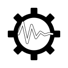

<p align="center">
  
</p>

# Groundwork: a local AI maintenance engineer for the plant floor

Groundwork watches rotating plant equipment on its own, diagnoses a developing fault before the line goes down and opens a work order that cites the sensor window, the equipment manual page and the maintenance history behind it. The whole agent runs locally on one Dell Pro Precision GB10 with Qwen3.6-35B-A3B: inference stays on the box, with no cloud calls, and OpenShell sandboxes the agent and blocks plant data from leaving. The technician stays in charge: Groundwork prepares the diagnosis and the cited work order, and the technician decides the next action on the board.

## Watch it first

The overview video is under [Releases](../../releases). It is a storyboard of this repo's screenshots and diagrams, not a recording of the demo running.

## How it works

| Stage | What happens | Check or human gate |
| --- | --- | --- |
| 1. Watch | The always-on hop loop (`scripts/hop-loop.py`, 1 Hz) writes L1 historian tags (not raw 12 kHz waveforms) into SQLite. | Values come from recorded CWRU or Mendeley windows or the cited sensor catalog; the loop never invents RMS values. |
| 2. Diagnose | When the hop data changes, the agent calls predictive-maintenance-mcp for the vibration and bearing-fault analysis. Groundwork does not rebuild that DSP. | The deterministic predictive-maintenance-mcp output is the fault classification; the model does not diagnose from prose. |
| 3. Gather evidence | The agent reads your equipment manuals and the CMMS history for the asset. | Every technical claim must carry a local citation (signal window, manual page or CMMS row); no invented pages, rows or parts. |
| 4. Open the work order | Groundwork opens a cited work order and shows it on the technician board: what needs attention, why, and the next action. | Human gate: the technician reviews the evidence and decides what to do. |
| 5. Ask Maintenance Assist | The technician can ask scoped follow-up questions about the selected asset. | Questions outside the asset, fault, evidence or cited documents are refused (`out_of_scope`). |
| 6. Prove containment | If anything tries to email or POST plant data off the box, OpenShell's L7 policy denies it. | The board shows only the deny lines read from the OpenShell gateway audit log; with no deny line it shows "Unproven". |

## Hardware

**Built and run on**

| Component | Built and run on |
| --- | --- |
| System | Dell Pro Precision GB10 (top configuration) |
| GPU | NVIDIA GB10 Grace Blackwell superchip, 128 GB unified LPDDR5x (shared by CPU and GPU) |
| CPU | 20-core NVIDIA Grace Arm CPU |
| Memory | 128 GB unified LPDDR5x (shared by CPU and GPU) |
| Storage | 4 TB NVMe SSD |
| OS | NVIDIA DGX OS |
| Software | NemoClaw, OpenShell, Qwen3.6-35B-A3B (local endpoint on 127.0.0.1:8000), Node.js, Python 3, SQLite, predictive-maintenance-mcp (no versions stated) |

## What's in this repo

| Path | What |
| --- | --- |
| `app/` | Board server and API (`app/server.mjs`), Maintenance Assist, local inference client, retrieval, OpenShell containment evidence |
| `agent/` | NemoClaw agent definition (`agents.yaml`) and the `plant-floor-maintenance` skill (`SKILL.md`, `TOOLS.md`, `AGENTS.md`) |
| `config/` | Agent and document-corpus configuration |
| `data/` | Synthetic CMMS history, sensor catalog, recorded hop tapes, seeded demo incidents, CWRU record metadata and the ISO 20816 scope notes |
| `demo/inject/` | Scripts that inject a catalogued fault (inner race, outer race, ball) and clear it |
| `deploy/` | Optional user systemd service for the board |
| `mcp/` | Where the setup expects predictive-maintenance-mcp (see Known limits) |
| `scripts/` | Hop loop, agent provisioning, corpus indexing, feed builders, data converters and the static preview build |
| `tests/` | Node test suite (`npm test`) |
| `web/landing/` | Landing page |
| `web/prototype/` | Technician board (incidents, floor, Asset 360, evidence, Maintenance Assist) with sample screenshots |
| `web/twin/` | 3D plant viewer (three.js, bundled in `web/twin/vendor/`) |
| `web/board/` | Assistance board view |
| `web/credits.html`, `web/licenses/` | Sources and licences for the bundled assets |
| `docs/RUNBOOK.md` | Full run-and-reset checklist |

## Setup (Linux, NVIDIA DGX OS on the Dell Pro Precision GB10)

1. Get this repo:
   ```bash
   git clone https://github.com/hermbiggie-a11y/groundwork-demo.git ~/groundwork
   cd ~/groundwork
   ```
2. Install the named prerequisites: NemoClaw and OpenShell (the scripts look in `~/.local/bin/` unless you set `NEMOCLAW` and `OPENSHELL`), Node.js, and Python 3 with numpy in a project virtual environment (`.venv`).
3. Serve Qwen3.6-35B-A3B on a local endpoint at `http://127.0.0.1:8000`. Copy the weights to internal NVMe before serving. Maintenance Assist reads its endpoint and model name from `INFERENCE_URL` and `INFERENCE_MODEL`; its built-in defaults (`app/lib/local-infer.mjs`) are `http://127.0.0.1:8080/v1/chat/completions` and `Qwen3-0.6B`, so set both to match the endpoint you serve.
4. Put predictive-maintenance-mcp in `mcp/predictive-maintenance-mcp/` (or set `PMMCP_DIR` to its folder). See Known limits.
5. Add the inputs, which are not shipped in this repo:
   - Bearing-vibration data: fetch the CWRU or Mendeley bearing data yourself under its own terms and put the `.mat` files in `data/cwru/` (provisioning uses `97.mat` and `105.mat`; `scripts/convert-mendeley.py` converts Mendeley recordings).
   - Your own equipment manuals: put the manual PDF in `data/manuals/` and point `MANUAL` at it (the default name is `skf-bearing-damage-analysis.pdf`).
6. Provision the agent into its OpenShell sandbox:
   ```bash
   ./scripts/provision-agent.sh
   ```
7. Start the board:
   ```bash
   node app/server.mjs
   ```
   Landing: `http://127.0.0.1:8765/` · Board: `http://127.0.0.1:8765/prototype/`
   (Optional: `./scripts/install-board-service.sh` runs the board as a user service.)
8. In a second terminal, start the hop loop:
   ```bash
   .venv/bin/python scripts/hop-loop.py
   ```
9. Inject a catalogued fault and watch Groundwork flag it and open the work order:
   ```bash
   ./demo/inject/inject-ir.sh
   ```
10. Run the tests:
    ```bash
    npm test
    ```
11. The full run-and-reset checklist, with fallbacks, is in [`docs/RUNBOOK.md`](docs/RUNBOOK.md).

## Known limits

- The overview video is a storyboard of this repo's screenshots and diagrams, not a recording of the demo running.
- No run time is claimed for any step.
- The 3D plant models (VLFT geometry, CC BY-NC 4.0, non-commercial) are left out of this copy, together with the landing page's renders of them (`web/landing/images/floor-iso.jpg` and `floor-top.jpg`). Get the models from the DigitalFactory / VLFT repository (`https://github.com/difactory/repository`) under their own licence and place the station `.glb` files in `web/twin/glb/` (the file names are listed in `web/twin/scene.json`).
- predictive-maintenance-mcp is not bundled in this copy. It is a named prerequisite: get it from its own project ([lgdimaggio/predictive-maintenance-mcp](https://github.com/lgdimaggio/predictive-maintenance-mcp)) under its own licence (see that project's LICENSE file) and place it in `mcp/predictive-maintenance-mcp/`. No version or commit of it is pinned here, so a newer version may behave differently from the one the demo was built with.
- Raw CWRU / Mendeley recordings and equipment manuals are not redistributed; you supply them (setup step 5).
- Only one asset (RPP1) is diagnosed from recorded CWRU vibration data and can raise a fault flag. The other stations show cited synthetic process and electrical tags; Maintenance Assist can discuss those tags but does not diagnose them. The maintenance history is synthetic.
- Only the inner-race fault has a verified manual page pin. For other fault types the manual citation comes from a keyword search of the manual and, if nothing matches, from a page in the middle of the manual chosen at random (`app/lib/rag.mjs`). With your own manuals, the pins in `config/corpus.json` need to be set for them.
- The CWRU 2 hp test rig is below the 15 kW machine-power floor of ISO 20816, so Groundwork reports deviation from a learned baseline and trend, never an ISO zone (`data/manuals/iso-20816-scope-notes.md`).
- The static preview (`npm run build`, `npm run preview`) is a noncommercial demonstration with simulated telemetry and prepared answers. It runs no model, connects to no plant and gives no containment proof, so it is not the product running.
- Headless Firefox on the GB10 has no WebGL; use a windowed browser to capture the Floor view.

## Credits

- **Created by the Groundwork team:** Mateo del Rio Lanse and Yahil Corcino Valdez. The original project is [mdelriolanse/groundwork](https://github.com/mdelriolanse/groundwork); please give it a star. Dell Technologies shares this copy with the team's permission.
- **Partner:** NVIDIA (the NVIDIA GB10 Grace Blackwell superchip and NVIDIA DGX OS in the Dell Pro Precision GB10).
- **Agent runtime and model:** NemoClaw and OpenShell run and sandbox the agent; Qwen3.6-35B-A3B is the local model. Each is a named product you install under its own terms.
- **Diagnosis:** [predictive-maintenance-mcp](https://github.com/lgdimaggio/predictive-maintenance-mcp) by lgdimaggio; please star it too. It is not bundled: it is a named prerequisite you place in `mcp/` under its own licence, and the setup points at that local copy (see Known limits).
- **Bundled third-party components:** three.js (MIT, `web/twin/vendor/`, licence in `web/licenses/three.txt`); Geist, Geist Mono and Instrument Serif fonts (SIL Open Font License 1.1, licences in `web/landing/fonts/`). The 3D plant geometry and the landing renders of it come from the DigitalFactory / VLFT repository under CC BY-NC 4.0 (`web/licenses/vlft.txt`). Data sources: the Case Western Reserve University (CWRU) and Mendeley bearing-vibration datasets, used under their own terms and not redistributed. All notices are in [`THIRD_PARTY_NOTICES.md`](THIRD_PARTY_NOTICES.md).
- **AI-generated assets:** the overview video under Releases is narrated with an AI-generated voice.
- **Trademarks:** Dell, Dell Technologies and Dell Pro Precision are trademarks of Dell Inc. or its subsidiaries. NVIDIA, Grace, Blackwell and DGX are trademarks of NVIDIA Corporation. Qwen, SKF, three.js, Node.js, Python, SQLite and the other product and company names here are trademarks of their respective owners. Their mention does not imply that they endorse Dell or this demo, or that Dell endorses them.

## Support

Logan Lawler, Dell Technologies: logan.lawler@dell.com

## License

The Groundwork team's code is shared under the terms in [`LICENSE`](LICENSE): all rights are reserved by the authors, and you may download, run and evaluate it as a demo. Dell's changes carry the same terms. It is not MIT licensed. Third-party components, models and data keep their own licences ([`THIRD_PARTY_NOTICES.md`](THIRD_PARTY_NOTICES.md)).
